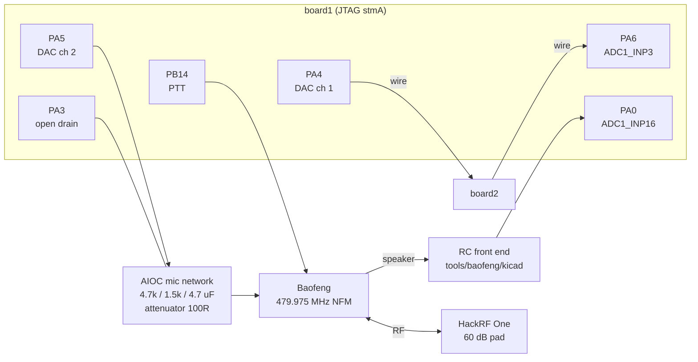

# The radio stand: a Baofeng on the board, a HackRF as the far end

The two-board stand proves the modem over a wire. This stand puts a
real FM radio between a board and the air: board1 keys a Baofeng UV-5R
class handheld, feeds its microphone and listens to its speaker, and a
HackRF One plays the other station — it transmits frames into the
radio the board listens to, and records what the board's radio sends.
The board-to-board wire stays connected throughout; the radio uses its
own pins.

Everything here was measured on 2026-11-15/17 unless dated otherwise.
The settings are described for operators in [console.md](console.md)
and specified in [modem-protocol.md](modem-protocol.md) (CONFIG keys
15–20).

## Wiring

The whole stand's connections — both boards' pin maps, the JTAG
chain, the Baofeng plug and the RF path — are in [stand.md](stand.md).

| Board1 pin | Goes to | Role |
|---|---|---|
| **PB14** | the radio's PTT driver | keyed for every transmission, active-high |
| **PA5** (DAC1_OUT2) | the mic network's input (R2, 4.7 kΩ) | every transmitted sample, scaled by `mic_gain` |
| **PA3** | the mic network's attenuator leg (R17 100 Ω ‖ C12 100 nF) | open-drain LOW = mic level (default) |
| **PA0** (ADC1_INP16) | the RC front end's output (J2 pin 2) | the receiver's input with `rx_input 1` |
| **PA4** / **PA6** | board2's PA6 / PA4 | the board-to-board wire, unchanged |
| GND | radio ground (2.5 mm sleeve), both networks | common ground |

The mic network is the [AIOC](https://github.com/skuep/AIOC) rev 1.2
microphone output, traced from its KiCad netlist: input → R2 4.7 kΩ →
node; node → R4 1.5 kΩ → GND; node → C13 4.7 µF → MIC+ (the 3.5 mm
ring); the attenuator R17 100 Ω ‖ C12 100 nF from the node to a GPIO.
With that GPIO low the node sits at ~94 Ω and the output is mic level —
the AIOC's own default for these radios (`TXBOOST 0`); released, it is
line level, 22 dB hotter. At our frame peaks (±1.24 V at the DAC, 3/4
scale) that is ~24 mV peak at MIC+ (line: ~0.3 V). The DAC sees
~4.8 kΩ to ground, at the STM32H743 output buffer's 5 kΩ minimum, as
the AIOC runs its own part.

The AIOC's PTT transistors hang off its PA0/PA1, which on these boards
are the receive input and the LED — they are not used; PTT stays on
PB14.

**Pins measured free** (input mode, internal pull flipped up/down
twice, the pin read back; it follows the pull both ways): PA0 (the LED
hunt), PA2, PA3 and PA5 on both boards. With the network soldered,
board1's PA2 and PA3 read low against the pull-up — the network's
load, which is how the wiring was confirmed. **PA2 is not a DAC pin**
on this part (only PA4 and PA5 are); the network's first wiring put
it there.

## Settings

| Key | Default | For this radio | What it does |
|---|---|---|---|
| `ptt_lead` (15) | 0 | ~400 ms, both stations | mid-rail after keying, before the frame: the TX radio's attack AND the RX radio's squelch (see the preamble trap below) |
| `ptt_tail` (16) | 0 | 0 | mid-rail after the frame — only safe if the peer's lead covers it |
| `rx_input` (17) | 0 = PA6 | 1 = PA0 | the receiver's input; switched between two conversions |
| `mic_boost` (18) | 0 = mic | 0 | 1 releases PA3: line level |
| `mic_gain` (19) | 0 dB | **−6 dB** (Wide channel) | digital gain on PA5 only, −40..0 dB |
| `chirp` (20) | — | — | action: one 280–2700 Hz test sweep of N ms |

None of them persist across a reset: a reflash returns the board to
PA6, mic_gain 0 and no lead.

## Tools (`tools/baofeng/`)

| Script | Does |
|---|---|
| `nfm_tone_tx.py` | HackRF NFM transmitter: a tone (+ DCS), or `--audio frame.npy` (12 kHz, peak deviation `--audio-dev`, default 1500 Hz, no pre-emphasis) |
| `modem_frame.py` | builds a link frame as audio: NO_DATA, or `--text` (a message the board delivers and acknowledges); `--seq` for repeats |
| `ptt_carrier_check.py` | HackRF receiver: keys PB14 over JTAG and looks for the carrier, or `--listen S --iq out.npy` records 50 kS/s IQ |
| `reply_decode.py` | FM-demodulates a recording and decodes it with the boards' C streaming receiver (`make -C cport interfrx`) |
| `mic_sweep.py` | the frame-level `mic_gain` sweep below, end to end |
| `chirp_measure.py` | the chirp linearity measurement below: records, or `--analyze` a recording |
| `frontend_sim.py`, `kicad/` | the receive RC front end: simulation and schematic (the PDF predates PA0 and still says PA6) |

## Measurements

### PTT and the radio's release tail

PB14 is held for exactly lead + frame + tail (the beacon's
`ptt_last_ticks`, every key-up). The HackRF hears the carrier only
while the pin is high (+27.7 dB in 30 kHz, one segment per key-up), and
the radio stays on the air **~0.35 s after release** (0.20–0.36 s over
all runs). The tail carries a 56 Hz tone at 0.35–0.7 kHz deviation —
the Baofeng's squelch-tail elimination (STE) burst — but switching STE
off removes the tone, not the tail: 3.97 s of carrier for a 3.64 s key
with STE off, 3.94–3.98 s with it on. The hang is the radio's own.

### Receive: HackRF → Baofeng → board1

| Test | Result |
|---|---|
| 1 kHz tone, ±2.5 kHz deviation, into PA0 | 2.15 Vpp = −3.7 dBFS, SINAD 35.9 dB, H2 −40.8 dBc |
| Speaker audio across the band | the receiver's de-emphasis: ~12 dB tilt, equalised by the modem |
| EXTREME NO_DATA frame, ±1.5 kHz peak, no pre-emphasis | decoded on board1, 16.2 dB (the EXTREME estimate's ceiling), `cap_overruns` 0 |
| EXTREME `--text "hello 73"`, 25.1 s on air | delivered over USB 26.2 s after the start; acknowledged |
| The same message, 15 more times (one repeat, two sweeps) | 15/15 delivered and acknowledged |

An idle board listens on EXTREME only; after a decode its request
rises (to rung 12 at 16.2 dB) and NORMAL becomes active, decaying one
rung per 45 s of silence. Read a board's capture ring over JTAG as
≤1024 samples just behind `g_cap_w` in one session: a whole-ring dump
over the 0.64 kB/s bridge is spliced while the converter writes.

### Transmit: board1 → Baofeng → HackRF, with modem frames

Board1's acknowledgement of each message, recorded by the HackRF and
decoded off the air (`mic_sweep.py`; `ptt_lead 1500` so the recording
holds the whole frame):

| `mic_gain` | Deviation, rms | 99.9 % peak | Decoded (flat / de-emphasised) |
|---|---|---|---|
| 0 dB | 2067 Hz | 4525 Hz | EXTREME 12.8 / 11.9 dB — the limiter clips |
| −3 dB | 1536 Hz | 4233 Hz | EXTREME 16.2 / 16.2 dB |
| −6 dB | 1098 Hz | 3115 Hz | EXTREME 16.2 / 16.2 dB |
| −9 dB | 782 Hz | 2211 Hz | EXTREME 16.2 / 16.2 dB |
| −12 dB | 555 Hz | 1559 Hz | EXTREME 16.2 / 16.2 dB |
| −15 dB | 395 Hz | 1149 Hz | EXTREME 16.2 / 16.2 dB |
| −18 dB | 284 Hz | 822 Hz | EXTREME 16.2 / 16.2 dB |

Board2 decoded every one of board1's acknowledgements over the wire —
16 of 16 that day, PA4 carrying them at full level, the last at
16.2 dB — and board1 counted no DAC underrun and no short frame: the
frames leave board1 intact. The spectrum of the demodulated audio rises
+15 dB from 300 Hz to 2 kHz: the radio's pre-emphasis; the modem
occupies 278–2347 Hz, and nothing inside it is cut. At 0 dB the
in-band 99.9 %/rms ratio is 2.15 against the 2.75 a pre-emphasised
frame has: the limiter flattens the peaks by ~2 dB.

16.2 dB is where the EXTREME estimate rails, so this table cannot rank
−3 to −18 dB; the chirp below can.

### Linearity: the test chirp

`config chirp 4000` at seven `mic_gain` levels, 0.5 s lead, the HackRF
recording first (`chirp_measure.py`; board1: 7 key-ups, 0 underruns,
0 short). The chirp has a modem frame's
RMS, so a level means the same for both. Gain relative to the −18 dB
sweep, input steps removed — 0 dB is linear:

| Frequency | 0 dB | −3 dB | −6 dB | −9 dB | −12 dB | −15 dB |
|---|---|---|---|---|---|---|
| 400 Hz | −0.07 | −0.08 | −0.06 | −0.16 | −0.11 | −0.07 |
| 700 Hz | 0.00 | +0.02 | +0.01 | 0.00 | −0.01 | −0.02 |
| 1000 Hz | −0.05 | −0.03 | −0.03 | +0.02 | −0.05 | +0.01 |
| 1400 Hz | −0.02 | −0.02 | −0.02 | 0.00 | −0.02 | 0.00 |
| 1800 Hz | −0.03 | 0.00 | 0.00 | −0.02 | +0.02 | +0.03 |
| 2200 Hz | **−0.95** | −0.19 | −0.24 | −0.10 | −0.25 | −0.35 |
| 2500 Hz | **−2.02** | −0.05 | −0.05 | −0.03 | −0.02 | −0.04 |
| 2650 Hz | **−2.46** | −0.04 | +0.01 | +0.02 | +0.02 | +0.02 |

(500 Hz and 2200 Hz scatter by a few tenths at every level: they sit
on lines of the HackRF's own comb, below.) The path is linear to ±0.1 dB up
to the radio's **deviation limiter at ~4.2–4.3 kHz peak**, which the
sweep reaches only at 0 dB above 2 kHz — the fundamental there is
4184/4247/4292 Hz at 2.2/2.5/2.65 kHz. A limiter that high says the
channel is set to **Wide**.

**Harmonics** at 0 dB, for fundamentals of 700/1000/1400 Hz: H2
−35.9/−38.7/−41.9 dBc, H3 −39.9/−43.8/−47.5 dBc. At lower levels the
dBc figures rise instead of falling: that is the measurement floor,
not distortion.

**Response** at −18 dB, re 1 kHz, against a 750 µs pre-emphasis:

| Frequency | 300 | 400 | 500 | 700 | 1400 | 1800 | 2200 | 2650 Hz |
|---|---|---|---|---|---|---|---|---|
| Measured | −18.9 | −8.8 | −6.3 | −3.7 | +3.0 | +4.7 | +6.2 | +7.9 dB |
| Pre-emphasis | −8.9 | −7.1 | −5.5 | −2.9 | +2.8 | +5.0 | +6.7 | +8.3 dB |

Pre-emphasis within 0.5 dB from 500 Hz to 2.65 kHz, plus the radio's
sub-audio filter below: −1.7 dB extra at 400 Hz, −10 dB at 300 Hz. The
lowest carrier, 281 Hz, arrives ~19 dB under 1 kHz; the equaliser and
the FEC carry it.

**SNDR** (fundamental against everything but it and its 2nd/3rd
harmonics, 250–3000 Hz) rises 3 dB per 3 dB of level at every
frequency, e.g. at 1 kHz 27.8/25.6/22.8/20.5/16.6/14.2/10.9 dB from 0
to −18 dB: below the limiter what limits it is additive — and that
floor turned out to be mostly the HackRF's (next section), so these
SNDR figures are lower bounds for the radio path.

### The noise floor, and the HackRF's 244 Hz comb

Keyed and silent (each sweep's PTT lead), the in-band floor as first
recorded was **65 Hz rms** of deviation, **69 %** of it in harmonics of
**244.14 Hz** (1 / 4.096 ms: lines at 489, 731, 977, 1220, 1466, 1709,
1954, 2197 Hz). **The comb is the HackRF's, not the stand's.** 4.096 ms
is exactly 8192 samples at its 2 MS/s receive rate — the 16 KB chunks
it moves to USB — and the comb follows the rate (a silent keyed carrier
from board1, 2 s of PTT lead, recorded twice):

| HackRF RX rate | 8192 samples | Comb found | Share of the floor |
|---|---|---|---|
| 2.0 MS/s | 4.096 ms → 244.14 Hz | 732.6, 976.6, 1220.6, 1464.6 … Hz | 67 % |
| 2.5 MS/s | 3.277 ms → 305.18 Hz | 305.1, 610.3, 915.4, 1220.6 … Hz | 88 % |

And RF gain does not touch it, while it does lower the rest:

| LNA (VGA 8) | Carrier, max\|iq\| | Comb, rms deviation | Rest of the floor |
|---|---|---|---|
| 0 dB | 0.013 | 52 Hz | 37 Hz rms |
| 16 dB | 0.063 | 49 Hz | 14 Hz rms |
| 24 dB | 0.149 | 49 Hz | 13 Hz rms |

A comb ADDED at the converter would shrink against a carrier 21 dB
stronger; this one is a fixed deviation, i.e. the HackRF's own
oscillator or clock is phase-modulated in step with its USB transfers
(the coupling path is inferred, not traced). The same comb sat in the
very first PTT runs, before any audio was wired (its 7th harmonic,
~1.7 kHz at ~50 Hz deviation). And at LNA 0 the carrier spans only
±3.6 codes of the HackRF's 8-bit converter, which is what the rest of
the floor at LNA 0 was.

So the radio path's own floor is **at most ~14 Hz rms** (what is left at
LNA 16–24 once the comb is excluded; part of that may still be the
HackRF), and a frame's in-band SNR on the air is at least ~43/41/38/35/
32 dB at 0/−3/−6/−9/−12 dB. Record with `--lna 16` or more, and read
any floor or SNDR here as the HackRF's limit first. To measure below
the comb, remove it in analysis: it is exactly periodic in the
HackRF's samples (8192 of them), so a template folded at that period
and averaged over the recording can be subtracted.

### The preamble trap

The first frame sweep read **−7.5 dB at every level**, with two of
seven decodes failing — and none of it was the radio. A HackRF switched
from TX to RX takes ~1 s to start, so every recording began 0.6 s into
the board's reply. The EXTREME receiver needs nearly its whole
preamble; a clean frame replayed through the boards' receiver:

| Start of the frame missing | 0 | 0.2 s | 0.4 s | 0.6 s | 0.8 s+ |
|---|---|---|---|---|---|
| Decoded SNR | 16.2 dB | 16.2 dB | 7.4 dB | −5.7 dB | no decode |

Ruled out on the way, each by measurement: dropped samples (identical
recording lengths, no phase steps inside any carrier), gain pumping
(the level over the frame follows the same pattern within 1.5 dB at
every setting), the radio's band-edge filters (simulated up to a 6th
order 300 Hz high-pass: 16.2 dB), pre-emphasis and the comb (16.2 dB),
and board1 itself (no underruns, no short frames, board2 at 16.2 dB on
the wire). The same arithmetic applies on the air: the lead has to
cover the transmitting radio's attack **and** the receiving radio's
squelch opening.

The EXTREME preamble, for reading such recordings: 3.41 s of a comb at
750/1125/1500/1875 Hz, then 1.71 s of the comb two carriers up
(937.5–2062.5 Hz), then the 8224-sample ZC symbol.

## Recommendations and open items

- **`mic_gain −6`** on this Wide channel: frame peaks 3.1 kHz, ~3 dB
  under the limiter, frame SNR ≥ 38 dB against the radio path's own
  floor. (−3 puts frame peaks on the limiter; a Narrow channel halves
  the deviation per volt and wants ~−12.) Board1 is set to −6 (not
  persistent: a reset returns 0).
- **`ptt_lead` ~400 ms on both stations** once two radios talk; measure
  the receiving radio's squelch opening before trusting it.
- **Measure past the HackRF**: record at LNA 16+ and fold the comb out
  (above) to get the radio path's real floor; the tools default to
  LNA 16 now, the tables above were taken at LNA 0.
- **Rank the clean levels with NORMAL replies**: the EXTREME estimate
  rails at 16.2 dB; a message asking for a NORMAL reply would read the
  real frame SNR.
- The receive front end's schematic PDF still shows PA6.
