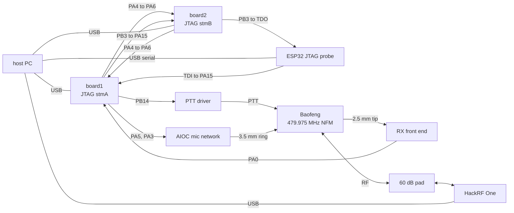

# The test stand: connections and pinout

Every wire on the bench in one place. There are two STM32H743 boards,
an audio wire between them, one ESP32 JTAG probe chained through both,
a Baofeng on board1, and a HackRF One as the radio's far end. The host
PC holds every USB end.

What the stand is used for, and what was measured on it, is documented
elsewhere:
- [radio.md](radio.md): the radio path's settings and measurements.
- [`tools/esp32-probe/README.md`](../tools/esp32-probe/README.md): the
  probe's internals.
- [`.claude/skills/test-analog`](../.claude/skills/test-analog/SKILL.md):
  the single-board loopback (PA4 jumpered to PA6 on one board).

State as of 2026-11-17.



## Who is who

| | board1 | board2 |
|---|---|---|
| JTAG target (dual config) | **stmA**, first in the chain (nearest TDI) | **stmB** |
| USB serial | `320047000851333438363436` | `240041000551333438363436` |
| Wired to the radio | yes (PB14, PA5, PA3, PA0) | no |
| Firmware | radio image with `rx_input`, `mic_*`, `chirp` | the previous radio image (its beacon says "rx_input not reported") |

The stmA ↔ board1 mapping was settled by measurement, not by the
config's declaration order. With PB14 driven high over JTAG, stmA's pin
read back loaded by the PTT driver, while stmB's rose freely.

Watch the naming: `host/board_bench.py` calls the boards A and B in
sorted serial order, so its **A is board2**. The `drive-boards` skill's
`A=` is board1. Always address a board by serial (`--serial`,
`--usb`), never by letter.

## The board: STM32H743VIT6, LQFP100

Pin numbers are the chip's LQFP100 package pins (DS12110, Figure 5 and
the pin table). The dev board's headers are labelled by port name.
Port H is bonded out as PH0/PH1 only, so PH2..PH15 do not exist on
this package.

| Pin | LQFP100 | Function | board1 | board2 |
|---|---|---|---|---|
| **PA0** | 22 | ADC1_INP16, the receiver's input with `rx_input 1` | RX front end J2.2 | free |
| **PA1** | 23 | on-board LED, **active-low** | LED | LED |
| PA2 | 24 | — (not a DAC pin) | free | free |
| **PA3** | 25 | mic attenuator, open-drain, LOW at boot | mic network R17 ‖ C12 | free |
| **PA4** | 28 | DAC1_OUT1: every transmitted sample | → board2 PA6 | → board1 PA6 |
| **PA5** | 29 | DAC1_OUT2: the same samples × `mic_gain` | mic network R2 | free |
| **PA6** | 30 | ADC12_INP3, the receiver's input with `rx_input 0` (default) | ← board2 PA4 | ← board1 PA4 |
| PA11 / PA12 | 70 / 71 | USB OTG_FS D− / D+ | host | host |
| PA13 | 72 | JTMS | ESP32 19 | ESP32 27 |
| PA14 | 76 | JTCK | ESP32 18 | ESP32 26 |
| PA15 | 77 | JTDI | ESP32 21 | board1 PB3 |
| PB3 | 89 | JTDO | board2 PA15 | ESP32 22 |
| PB4 | 90 | NJTRST (optional, has an internal pull-up) | ESP32 23 | ESP32 13 |
| NRST | 14 | reset | ESP32 25 (shared) | ESP32 25 (shared) |
| **PB14** | 53 | PTT, **active-high** | PTT driver input | free |
| PH0 / PH1 | 12 / 13 | 25 MHz crystal | crystal | crystal |
| VDDA | 21 | analog 3.3 V | (board 3.3 V to front end J2.1) | — |

The die temperature is read on ADC3's internal channel and uses no pin.

The radio image drives these pins on **any** board it runs on, wired
or not:
- PB14: push-pull output, low when idle.
- PA4 and PA5: the DAC, parked at mid-rail (~1.65 V) when idle.
- PA3: open-drain low.
- PA1: the LED.

Before flashing it onto a board where any of those pins is used for
something else, rewire. Pins **measured free** with a pull test (input
mode, internal pull flipped up and down, read back) on both boards are
PA0, PA2, PA3 and PA5. Measure any other pin the same way before using
it.

## The audio wire between the boards

| From | To | Notes |
|---|---|---|
| board1 PA4 | board2 PA6 | plain wire, no coupling parts |
| board2 PA4 | board1 PA6 | plain wire, no coupling parts |
| GND | GND | common, via the probe's ground and USB |

The DAC swings 0.5–3.1 V around mid-rail; a frame's peaks are ±1.24 V,
because playback runs at 3/4 scale. The ADC samples at 12 kHz, 16-bit.
No DC blocking is needed on the wire, for two reasons:
- The receiver is DC-blind by construction (`src/dcblock.h`).
- The idle DAC parks at mid-rail.

The wire stays connected while the radio is in use. Board1 listens to
the radio on PA0 (`config rx_input 1`), and board2 keeps hearing
board1's PA4. PA4 carries the same frame the radio gets on PA5, so
board2 decodes board1's over-the-air replies over the wire as a
cross-check.

## JTAG: one ESP32 probe, both boards

The two boards are daisy-chained as a JTAG chain
([`stm32h7-rbb-dual.cfg`](../tools/esp32-probe/stm32h7-rbb-dual.cfg)):

```
ESP32 21 (TDI)   --> board1 PA15
                     board1 PB3  --> board2 PA15     (the chain wire)
                                     board2 PB3  --> ESP32 22 (TDO)
ESP32 18 (TCK)   --> board1 PA14     ESP32 26 --> board2 PA14
ESP32 19 (TMS)   --> board1 PA13     ESP32 27 --> board2 PA13
ESP32 23 (nTRST) --> board1 PB4      ESP32 13 --> board2 PB4   (optional)
ESP32 25 (nSRST) --> board1 NRST  +  board2 NRST              (shared)
GND common to the probe and both boards; each board on its own supply.
```

On the host side, the ESP32's USB serial (CH340, `/dev/ttyUSB*`) is
bridged to TCP port 3335 at 921600 baud by `rbb_bridge.py`
(`make -C cport bridge`). OpenOCD connects to that port.

Run one OpenOCD session at a time. The chain has two consequences you
will run into:
- **nSRST resets both boards.** Reset one alone with SYSRESETREQ:
  `targets stmA.cpu0; mww 0xE000ED0C 0x05FA0004`.
- **If the ESP32 reboots, both boards reset.** GPIO25 dips low while
  the ESP32 boots, and that dip reaches NRST. A USB re-enumeration, or
  a brownout when a jumper goes in near the probe, is enough. The tty
  can come back under a new name; restart the bridge on it.

## The radio (board1 only)

### Baofeng K1 plug

The plug's contacts, from the AIOC's connector note
(`kicad/k1-aioc/k1-aioc.kicad_sch`):

| Plug | Contact | Signal | On the stand |
|---|---|---|---|
| 2.5 mm | tip | SPK+ | RX front end J1 SPK+ |
| 2.5 mm | ring | TxData (programming, from the radio) | — |
| 2.5 mm | sleeve | GND | board1 GND, front end SPK− (via JP1), mic network ground |
| 3.5 mm | tip | +V / PTT2 | — |
| 3.5 mm | ring | MIC+ | mic network C13 |
| 3.5 mm | sleeve | PTT1 / RxData (to the radio) | PTT driver (see below) |

A K1 radio transmits while PTT1 (the 3.5 mm sleeve) is pulled to
ground. **The PTT driver's own circuit is not recorded in this
repository.** What is measured:
- The driver is active-high from PB14.
- The radio carries a carrier only while the pin is high.
- After release, the radio stays on the air for another ~0.35 s.

### Mic network (AIOC rev 1.2, traced from its netlist)

```
PA5 --R2 4.7k--+--C13 4.7u-->  MIC+   (3.5 mm ring)
               |
               +--R4 1.5k--> GND
               |
PA3 --(R17 100R || C12 100n)-+
```

Two levels, selected by PA3:
- **Mic level** (`mic_boost 0`, PA3 held low; the default): the node
  sits at ~94 Ω, so frame peaks reach MIC+ at ~24 mV.
- **Line level** (`mic_boost 1`, PA3 released): 22 dB hotter, ~0.3 V
  peak.

The DAC sees ~4.8 kΩ to ground, at the H743 output buffer's 5 kΩ
minimum. `mic_gain` (−40..0 dB) scales PA5 only. Set it to −6 dB for
this Wide channel.

The AIOC drives PTT from its own PA0/PA1. On these boards, PA0 is the
radio receive input and PA1 is the LED, so the stand keys PTT from
PB14 instead.

### RX front end (`tools/baofeng/kicad/baofeng_rx_frontend`)

```
SPK+ --C1 2.2u film--R1 3.9k--+--R3 100--+--> J2.2 --> PA0
                              |          |
                           R2 2.0k    C2 27n C0G to GND
                              |       D1 BAT54S clamps to VDDA / GND
                             VB = VDDA/2  (R4/R5 10k/10k, C3 10u)
SPK- --JP1--> GND     close JP1 only if SPK- sits at 0 V DC
J2: 1 = VDDA (board 3.3 V)   2 = PA0 (rx_input 1)   3 = GND
```

Simulated (`frontend_sim.py`, ngspice):
- **Response:** passband −9.66 dB, −3 dB at 5.7 Hz and 4.38 kHz.
- **Clamps:** hold the pin within −0.33..+3.63 V for inputs up to
  20 Vpp.

Measured:
- **Input:** 6 Vpp at the speaker for a 1 kHz tone at ±2.5 kHz
  deviation, at the volume set on the stand.
- **At PA0:** 2.15 Vpp, −3.7 dBFS.

The schematic's PDF predates the move to PA0 and still says PA6. The
`.kicad_sch` file is current.

### RF: Baofeng to HackRF

```
Baofeng antenna SMA --> 60 dB attenuator --> HackRF One ANT
```

| | |
|---|---|
| Channel | 479.975 MHz NFM, no CTCSS/DCS. Wide: the measured deviation limit is ~4.2 kHz |
| Level at the HackRF | ≤ 5 W = +37 dBm → −23 dBm after the pad. The HackRF's limit is −5 dBm, so its 14 dB RX amp stays **off** |
| HackRF TX (`nfm_tone_tx.py`) | AMP 0, VGA 20, offset tuning 200 kHz, 2 MS/s |
| HackRF RX (`ptt_carrier_check.py`) | 2 MS/s, offset tuning 200 kHz, VGA 8, LNA 16 in the measurement tools (the script's own default is 0) |
| HackRF clock | internal 10 MHz reference module on CLKIN (nothing on the SMA) |

The HackRF's receiver adds a comb of its own: the period is 8192 of its
samples, 244.14 Hz at 2 MS/s. Treat it as an instrument artifact, not
something on the stand ([radio.md](radio.md#the-noise-floor-and-the-hackrfs-244-hz-comb)).

## Host connections

| Device | Host side | Driven by |
|---|---|---|
| board1, board2 | USB OTG_FS, addressed by serial | `host/ofdm_modem.py`, `demoapp/board_console.py`, `ofdm_console --usb` |
| ESP32 probe | `/dev/ttyUSB*` (CH340) → `rbb_bridge.py` → TCP 3335 | OpenOCD, `cport/bench/radio_beacon.py`, `ptt_carrier_check.py` |
| HackRF One | USB, SoapySDR `driver=hackrf` | `tools/baofeng/*.py` |

## Settings that do not survive a reset

The radio needs four non-default settings, and a reflash or reset
returns board1 to defaults (PA6 input, mic_gain 0, no PTT lead).
After every reset, apply:

```
config rx_input 1      # listen to the radio on PA0
config mic_gain -6     # Wide channel
config mic_boost 0     # mic level (already the default)
config ptt_lead 400    # once two radios talk; 1500 when the HackRF records a reply
```

See [radio.md](radio.md#settings) for what each one does.
